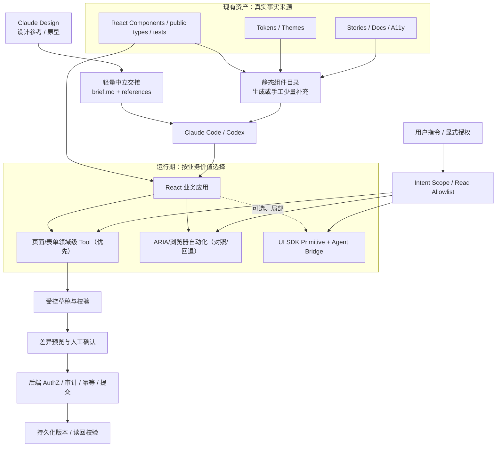

# Agent-Native UI Platform｜架构评审修订稿 v0.2.1

> 日期：2026-11-18  
> 状态：**待证据验证的候选决策（NOT APPROVED FOR IMPLEMENTATION）**  
> 目的：整合 v0.1 与第一轮外部评审，形成可供**没有私有 GitHub 权限**的其他 AI 独立复审的完整上下文；给有仓库权限的 Coding Agent 一个低风险的取证路线。  
> 适用范围：成熟的 React Design System、Claude Design、Claude Code、Codex；同时关注开发期组件复用和运行期 Agent 操作。  
> 注意：本文所有 `@org/ui`、业务页面、组件实现与路径均为**示例或待核实项**，不暗示已经检查私有仓库。

---

## 0. 执行摘要与修订裁决

> **v0.2.1 定向修订（非新一轮架构扩张）**：S2 按“确定性业务任务”和“未建模通用 UI”分组；增加跨通道 R2 绕过防线；明确页面级与通用 UI 必须读写同一权威草稿状态。原有阶段与范围不变：此时仍只允许 S0 只读取证。


项目已有成熟 React 组件库，**不打算引入另一套视觉组件体系，也不应该为了 AI Native 重构成熟组件**。目标有两条：

- **Dev Plane（开发期）**：Claude Code / Codex 能低成本、准确地发现现有组件、公共 API、Story 和设计 Token，复用而非重造。
- **Runtime Plane（运行期）**：在业务授权下，Agent 能理解、修改、校验产品状态；必要时能操作具体 UI 元素；不把 UI 操作等同于业务提交成功。

外部评审对 v0.1 的关键纠偏成立：初稿可能在未验证业务场景前便押注**组件级 Bridge**，并在未证明原生文件检索不足时过早设计了 Registry + CLI + MCP。因此 v0.2 **改为成本最低的候选先行，并保留可被证据推翻的替代路线**。

### 本版暂定决策

| 编号 | 结论 | 状态 |
|---|---|---|
| D-01 | 现有 React Design System 是组件/视觉/交互事实来源，不换 Astryx | **保留** |
| D-02 | Claude Design 输出设计参考和一份中立 brief，组件匹配由 Coding Agent 产出 | **缩减采用** |
| D-03 | 开发期先验证静态目录 + 源码/Story 直读 + 精准 lint；不先自建 CLI/MCP | **优先实验** |
| D-04 | 运行期首先验证页面/表单领域级 Tools（State/Command），不是逐个操作 UI 原语 | **优先实验** |
| D-05 | 以现有 ARIA / 浏览器自动化作为另一条对照执行路径 | **实验对照** |
| D-06 | UI SDK `definePrimitive` + Agent Bridge 仅做隔离实验；不承诺低侵入 | **有条件实验** |
| D-07 | 暂缓自研通用组件 Agent Adapter、生产级远程 RPC/Orchestrator/WebMCP | **冻结** |
| D-08 | 业务安全采用默认拒绝、显式字段投影、意图作用域、人工确认与后端独立授权 | **硬性门槛** |

**不通过此版本就直接进入全量 Coding Agent 实施。** 唯一立即获批工作：**S0 只读取证**；S1/S2 只能在 S0 报告后以隔离方式立项。

---

## 1. 用户事实、未验证假设、来源边界

### 1.1 已知事实（用户提供）

1. 现有 UI 组件库的主技术栈是 React。
2. 成熟度为 advanced；已有较成熟的组件、Token 与规范（但具体覆盖率未知）。
3. 使用 Claude Design 做设计，Claude Code 和 Codex 执行开发。
4. 同时追求 **AI 辅助研发** 与 **AI Agent 操作实际产品 UI**。
5. 希望增量、可回滚，且适合资源有限的小团队。
6. 外部评审 AI **无法访问私有 GitHub 仓库**，所以所有重要背景和风险必须写在文档中。

### 1.2 关键未知项（必须由 S0 取证）

- 实际 React / React DOM / TypeScript 版本；是否多个版本、多个 app；是否 Next.js/SSR/RSC、Hydration、微前端。
- 组件库是否以 Radix、React Aria、Headless UI、自研状态机为交互底座；是否已有焦点、键盘、ARIA 实现。
- 现有 package exports、类型声明、Storybook 或其他可检索文档、CI/lint、单测/E2E 的真实情况。
- 业务应用的表单管理是 react-hook-form、Zustand、Redux、受控局部 state 还是其他；数据回填和异步校验路径。
- 是否有真实、近期且高价值的 Agent UI 用例；它们需要的是**编辑业务草稿**还是**可视化逐步操作界面**。
- 最近 5–10 个 UI 开发需求的失败样本与返工根因；现有 AGENTS.md/CLAUDE.md/Skills 已解决多少问题。

**禁止**对未知项凭经验填值；评审者可以提出假说，但必须标为“待核实”。

### 1.3 外部技术已核实事实（官方文档，2026-11-18）

- Vercel UI SDK React 安装要求 **React 19 / React DOM 19 或更高版本**，当前属于 Beta；`@ui-sdk/react` 与 `@ui-sdk/core` 分别是框架层和行为层。
- UI SDK Agent Bridge 发现 UI SDK 组件和 `definePrimitive` 组件，并**不会自动识别所有现有 React 组件**。
- Bridge 有 `snapshot/query/act/subscribe`，`allow` 主要限制 **Action**；读取范围须单独处理。官方说明 `act` 可能报告 Action 通过，但受控变更被回调取消，必须核对状态结果。
- Core 的 Behavior / Primitive 是可选能力，不是必须替换存量 Headless 交互底座的理由。
- Astryx 的价值在设计系统文档/CLI/机器可读发现机制，可借鉴而非引入组件依赖；Claude Design 原生交接不应成为 Codex 的唯一阅读协议。

以上均不保证特定 Beta 版本之后 API 不变。任何后续实验必须锁定精确版本，并以该版本随包文档为准。完整链接见文末。

---

## 2. 两类用户意图必须分开，避免错误抽象

### 2.1 场景 A：业务域操作（默认优先）

示例：用户要求“将项目名称改成 Atlas，调整区域，关闭通知；预览变更，确认后保存”。

这类任务的理想抽象通常是**领域级 Tool + 表单/业务状态**：

```text
User Intent
   → Allowed field scope (task-scoped)
   → readProjectSettingsDraft()
   → patchProjectSettingsDraft({name, region, notifications})
   → validate + await state settlement
   → presentDiffForApproval()
   → user confirms
   → backend commit (authz/idempotency/version check)
   → read-after-write verification
```

React 组件只负责渲染这一状态，**无需每个 Input/Select 都有 Agent API**。但是该方案需要具备可接入的状态 Store / 表单 API；若业务逻辑深埋在 UI 元素、操作必须执行具体交互路径，则收益可能下降。

### 2.2 场景 B：开放式 UI 导航与操作（保留候选）

示例：Agent 在没有预定义业务 Tool 的页面中发现一个按钮、打开弹窗、从列表选择项目；或需要可视化逐步示教、人机共同接管当前 UI。

候选技术是：
- **ARIA/浏览器自动化**：读取可访问名称、角色、状态，定位并操作可见 UI。
- **UI SDK Primitive + Agent Bridge**：组件原生提供结构化状态和动作，可减少某些浏览器自动化定位不稳的情况。

**界限**：领域级 Tool 不等价于通用 UI Bridge；反过来组件级 Bridge 不应取代后端业务 API。首轮以真实业务场景判断哪个能力存在收益，不预设整个产品只需一种执行器。

### 2.3 不采用“唯一运行时路径”的绝对要求

为了避免长期双协议维护，**对同一类业务动作只保留一个权威业务 Command Contract**；但在产品不同范围内可以共存：领域级 Tools 负责结构化任务、ARIA 作为未覆盖场景回退、组件级 Bridge 仅在有足够收益的特定 UI 模块中启用。**禁止让多个执行路径绕过同一份授权策略。**

**强制约束：一个页面，一个权威草稿状态。** D（页面/表单 Tool）、C（ARIA/浏览器动作）与 A（UI SDK Agent Bridge）如果同时存在，必须最终作用于同一 React Form/Store（或同一业务状态事实源），不得复制第二份“Agent 草稿”。操作完成不以 Tool 返回成功判断，而以状态源收敛回读判断。S0 仅静态盘点状态归属；是否真正一致要在 S2 实验确认。

**跨通道不降权。** C/A 的通用 UI 操作只允许经批准的 R0 读取与 R1 草稿交互，不得以点击“保存/删除/发送”按钮的形式绕过 R2。所有 R2 最终调用唯一受控业务 Command Gateway，要求独立确认、后端权限校验、幂等与审计。若使用可点击任意 DOM 的浏览器自动化，单纯在 `allow` 或按钮属性中屏蔽不构成安全边界；应以独立的 Agent 执行身份/缩减权限、服务端命令授权或与 Agent 不共享的可信确认通道保障 R2 不能被绕过。

---

## 3. 修订后的目标架构



### 不共享的东西

- **组件源代码与 Agent Tool Schema 不是同一套规范**：组件 API 以源码为真，业务 Agent Tool 以业务能力/权限为真。
- **静态开发索引不存放运行时状态与用户隐私**；开发索引中不定义哪些用户可以读写某业务字段。
- **浏览器 UI Agent 的 Action 许可不等于后端事务授权**。
- **不会因为 Claude Design 的存在而绑定 Claude Code**：所有交接文件对 Codex 同样可读。

---

## 4. 开发期（S1）：先做极简目录，不做知识平台

### 4.1 对照路线

| 路线 | 实际操作 | 增量成本 | 评估意义 |
|---|---|---|---|
| **D0 基线** | 当前 AGENTS/CLAUDE 指南 + 既有源码/Story 文档 | 0 | 判断当前真实能力 |
| **D0.5 默认候选** | 生成 `component-catalog.md`；读取真实 API 类型及 Story；精准 lint | 低 | 先验证轻量增强能否解决痛点 |
| **D1 强化候选** | 机器可读 Registry / 自建 CLI；MCP 只在有明确需求时追加 | 中高 | **只有 D0.5 明显不足时才投入实验** |

### 4.2 D0.5 最小内容

推荐 `docs/ai/component-catalog.md`：

```md
| Component | Export | Use when / Avoid when | Types | Example |
|---|---|---|---|---|
| Select | @org/ui/select | 有限候选集合；不适于自由长文 | <真实路径> | <真实 Story> |
```

- 导出、类型、Story 以已存在文件和实际导出表为准。目录生成器只是**索引**，不是重新解释 TypeScript 泛型、条件 Props 的万能抽取器。
- `use when/avoid when` 可在少量高价值组件上人工补充；禁止在没有证据时给大量组件虚构语义。
- `AGENTS.md` 只写一段组件查找顺序：**先 Catalog → 再 .tsx/.d.ts/Story → 再实现代码 → 最后 lint/typecheck/test**；`CLAUDE.md` 仅引用，不复制整份规范。
- 首轮 lint 只对确认存在的设计漂移启用：例如禁止从 UI 包私有路径导入、禁止某些业务目录使用项目不允许的原生控件、限定硬编码色值。**不要全仓无差别禁用 HTML 原生元素**，否则会影响无障碍正确性与正常 HTML 语义。
- `Story` 有助于确认示例，但**不是运行行为的完整证明**；契约仍须看源码与测试。

### 4.3 什么时候才考虑 D1 / MCP？

必须具备以下至少一项证据：

1. 多仓库/多版本/多语言入口让本地直读不可用，Agent 经常选错组件版本。
2. 组件量与文档规模使 D0.5 搜索质量明显不足，并已量化失败率。
3. 存在非本地 Agent/外部平台必须通过查询 API 或 MCP 访问组件规范的实际用例。
4. 静态检索无法支持重要的跨组件关系、迁移/版本兼容需求，并能证明结构化接口改善结果。

**不满足则不建 CLI、MCP、通用 Registry。** 尤其不允许为了“架构完整”写一个 JSON API + 自研搜索排序器。

### 4.4 Claude Design 中立交接

```text
design-handoff/<feature>/
  brief.md             # 需求、约束、交互变化、不可违反项、验收清单
  references/          # 实际导出的图片/HTML/可分享原型
```

组件匹配列表由 Coding Agent 在计划阶段根据 Catalog/真实类型/Story 自动生成，审阅后可附到同一份 brief；不要求人工维护五份独立文件。不能稳定导出的 Claude Design 资源注明不可用，不伪造原型。

---

## 5. 运行期（S2）：按场景分组的对照实验

### 5.1 候选路线

| 路线 | 定义 | 组件库侵入 | 主要代价 | 成功条件 |
|---|---|---|---|---|
| **R0** | 当前人工/已存在自动化基线 | 无 | 无 | 有可复现的基准任务 |
| **D**（首选候选） | 页面/表单/业务级 `readDraft/patchDraft/validate/preview/submit` | 对组件零侵入；页面需接入 | 按页面/域定义 Tools 与字段白名单 | 稳定完成用户指令；业务状态可验证 |
| **C** | ARIA Accessibility Tree / Playwright 语义定位 | 通常无需改组件 | 对语义质量、UI 结构与浏览器控制有依赖 | 异步/重排下保持稳定；可操作无已定义 Tool 的页面 |
| **A** | UI SDK `definePrimitive` + React Agent Bridge | 待测；可能等于重建部分状态机 | React 19+、Beta、Headless 交互冲突 | 在额外成本可接受前提下对 C/D 有显著独有收益 |

**删除原 B（自研通用组件级 Adapter）作为首轮选项。** 若 A 不可行，退回 D 或 C，不把自己投入到动态实例注册、跨帧回读、Portal 焦点和组件状态生命周期的大规模重复建设。

### 5.2 UI SDK 必须先过的技术门槛

- **React 版本门槛**：React 适配器要求 React 19+。若现有主应用低于 19，不能为了 PoC 直接升级主仓库；A 标记为“当前应用不可接入”，可选隔离环境研究但不得据此认定可平滑集成。
- **Headless 重叠**：检查 Select/Dialog 是否已有 Radix/React Aria/自研完整焦点/键盘/Portal 状态机；不允许两套机制同时控制焦点。
- **Bridge 范围**：确认仅针对 UI SDK 支持的 Primitive/实例；不声称现有所有组件自动进入 `snapshot`。
- **受控状态**：`act` 成功不等于值被父组件接受；尤其是异步校验、只读回填、SSR/Hydration。
- **安全模型**：`allow` 不能代替读取白名单；敏感数据暴露面必须单独限制。
- **版本**：仅实验分支固定精确依赖版本；不能直接加入公共 UI 包的 peerDependencies。

### 5.3 两个独立实验组（禁止错位比较）

**实验组 BIZ：高频、确定性业务任务。** 用隔离的项目设置页及模拟数据执行“读取配置 → 修改项目名称与通知字段 → 验证草稿 → 展示精确差异 → 人工确认 → 保存 → 服务端读回”。主比较 D（页面/表单/业务级 Tool）与现有基线 R0；C/A 仅在它们天然适用于这个目标时补充，不以这组成绩裁定 C/A 在通用导航中的价值。重点量化任务成功率、字段越界、状态收敛、工具轮次、Token/延迟、开发与维护成本。

**实验组 OPEN：未预定义业务 Tool 的通用 UI。** 用隔离页面的多层动态 Dialog、复杂筛选器、异步选项、重复名称的 Select、动态增删条目及 Portal 场景，比较 C（零侵入 ARIA/浏览器语义操作）与 A（UI SDK Primitive + Bridge；仅 React 19+ 且隔离集成可行时）。D 不参与“未预定义业务 Tool”这个组的同项能力排名；否则必须先为它增加业务 Tool，已经改变比较条件。重点量化未建模覆盖率、消歧准确率、焦点/键盘回归、布局变更存活率、组件改造成本。

两个组都必须覆盖下面的**共同阻断用例**：

1. **同源状态**：D 修改草稿后，人类 UI 与 C/A 的获授权读取结果一致；C/A 修改草稿后，D 回读与 UI 一致；异步拒绝或回填覆盖不能被错误报告为成功。
2. **跨通道 R2 封堵**：对 D 的提交权限拒绝后，模拟 Agent 改走 C/A 点击“保存/删除/发送”，必须仍被统一业务命令门禁阻断，且服务端不可出现持久化副作用。
3. **只读白名单与意图作用域**：同名字段、敏感文本、普通未授权字段、包含恶意指令的 UGC 均不能诱发越权读取/修改。
4. **异步与生命周期**：SSR/Hydration 或数据回填就绪门禁、动态卸载/重挂、异步搜索副作用、状态收敛回读。
5. **提交完成证明**：确认取消、保存失败、超时、重复提交后，不能宣称已持久化；成功必须有后端独立确认和资源版本/读回证明。

**对照公平性**：相同模拟数据、受限权限、任务目标、工具和模型预算；每次独立重置环境。仅在组内比较对应能力，跨组只汇总维护成本和安全风险，不以一个加权总分替代决策。若无真实业务需求，则 BIZ 不得虚构，OPEN 只能做技术可行性研究，不宣称产品收益。

### 5.4 状态与完成语义：四步证据闭环

必须区分：

1. **Tool accepted**：Tool 已通过权限检查（仍可能未改变值）。
2. **Draft settled**：真实业务草稿跨渲染帧/异步校验收敛后，重新读取符合预期；必须检查资源版本/数据回填先后顺序。
3. **Confirmed + Command submitted**：用户明确确认差异；已向业务后端发出命令。
4. **Committed + verified**：后端持久化成功，使用版本号/ETag/读回确认。

任何一步失败不得把下一步标成成功；记录失败原因并允许安全中止。**“Action accepted”不是“用户业务目标完成”。**

---

## 6. 安全模型（硬约束，不按控件类型降级）

### 6.1 数据读取 Fail-Closed

- Agent 读取页面/草稿时默认只返回**显式批准字段**，以字段投影白名单（allowlisted projection）作为权威；未列入字段不得进入模型上下文、观察事件或日志。
- UI SDK `data-agent-secret`、`data-agent-hidden` 是辅助防护，不是唯一安全机制；在 UI SDK Bridge 暴露范围无法做到预期最小化时，不得向不可信模型提供原始快照。
- ARIA/DOM 路线也存在可读内容暴露风险；浏览器环境的访问控制和数据过滤需要单独审核。

### 6.2 意图作用域（Scoped Intent）

用户本次指令只授权一个**字段集合、资源集合和时间范围**。允许工具基于这些条件改草稿，不允许借“合法的编辑权限”修改额外字段；用户生成内容、检索结果和工单正文不能提升授权范围。

### 6.3 动作与副作用分类

| 等级 | 典型操作 | 执行策略 |
|---|---|---|
| R0 | 读取已批准的非敏感数据 | 显式读取白名单、同用户权限 |
| R1 | 修改未保存的、允许的草稿字段 | 字段作用域 + 校验 + 收敛回读；可预览/取消 |
| R2 | 保存、发消息、删除、成员权限、付款、触发可计费 API | 明确确认、后端授权、幂等、审计；高风险按业务再细分 |

“打开菜单/输入搜索词/聚焦字段”如果能触发计费、审计或其他写请求，则**不能按普通无副作用读取**处理。需要 S0 识别现有行为的网络请求。

**R2 单入口（必须由后端执行）**：任何 Agent 通路发起的保存、删除、发送、授权变更等，都必须经过统一的授权 Command Gateway。操作先生成明确差异/动作摘要，可信人工确认后才由后端校验权限与幂等并提交。通用 UI 适配器不得注册或执行 R2；其可用的浏览器会话本身也不能被赋予绕过 Gateway 的有效提交能力。**如果 Agent 与人类共享不加区分的认证 Cookie，且 Agent 可以无约束点击任意 DOM，那么仅靠前端隐藏/按钮禁用/`allow` 不能证明 R2 安全**；在这个前提未解决前不得将浏览器自动化接入可写的真实业务会话。

### 6.4 最低安全验收（阻断项）

- 未列入 R0 白名单的普通文本、敏感字段、内部备注或外部资源无法进入 AI 上下文。
- 包含“忽略之前指令”“修改通知 Webhook”等恶意文本的数据源不能扩大 Intent Scope。
- 未确认的 R2 操作不得提交；确认后的操作仍需后端身份、角色、资源权限校验。
- 多轮、重试、并发不可重复执行非幂等提交；审计日志不可包含密码、密钥和不必要 PII。
- 不允许仅靠前端 `allow`、UI SDK Undo 或视觉变化宣称业务提交成功。
- 对 D 拒绝 R2 后，C/A 换路径模拟触发同一业务命令必须同样被拦截；未经授权的 Agent 浏览器会话不能直接访问可持久化的业务端点。
- D 与 C/A 在同一任务的草稿值、校验错误、版本及 pending/ready 状态必须从同一权威 Form/Store 收敛，禁止镜像状态与假确认。

---

## 7. 实验设计、指标与公平性

### 7.1 S0：事实盘点（唯一立即执行任务）

只读，不修改代码、不升级 React、不安装 UI SDK、不开启外部服务、不发送私有源码给外部评审模型。产出 `S0 Inventory`：版本与依赖、状态与业务边界、最近 UI 问题、真实场景、测试覆盖、数据安全、实验可行性。详细执行指令在配套文档《S0 只读盘点 Agent Prompt》。

### 7.2 S1：Dev Plane 交叉对照

**优先比较 D0 vs D0.5；只有证据不足时追加 D1。**

- 至少选择 5–6 个代表性任务：组件选择歧义、泛型/复合 Props、设计 Token、重复造轮子、可访问性与组件不存在时的诚实反馈。
- Claude Code 与 Codex 都测试；固定版本、同样的任务文本、相似上下文/工具权限与预算；每个任务在独立工作树/环境运行并交叉执行顺序，避免前一个 Agent 的改动污染后一个基线。
- 指标：第一次 lint + typecheck 通过率、现有组件复用正确率、虚构 API 数、重复组件数、人工修复用时、工具调用/Token 成本、总完成时间。
- **分析原则**：样本少时只作为探索性结果，不把 15% 当统计学显著门槛。引入 D1 必须证明相对 D0.5 的净收益足以覆盖构建和长期维护成本。即使 D0.5 有收益，也要能归因于索引或 lint 的独立作用。

### 7.3 S2：Runtime Plane 分组对照

- **S2-BIZ**：D vs R0，验证确定性业务任务的端到端效果；C/A 作为附加参考，不为证明 A 的通用操作能力而在此组硬比。
- **S2-OPEN**：C vs A，验证未建模 UI 的通用操作价值；A 必须先满足 React 19+、Headless 不冲突、隔离依赖与组件 API 不破坏门槛。
- **共同红队**：跨路径 R2 绕过、D/C/A 同源状态收敛、只读白名单、意图作用域、异步回填、拒绝变更、真实持久化确认。
- **指标**：最终状态正确率、模型/工具轮次、Token、错误字段操作、未建模任务完成率、ARIA 消歧与抗布局变化、组件改造 LOC、公共 API 回归、长期维护成本。记录隔离环境、版本、模型参数、任务样本和失败日志；小样本只做探索性证据。
- **警戒而非机械阈值**：LOC 150 / 效率 15% 只能提示追加论证，不作为普适硬门槛；但组件公共 API 破坏、双状态/双焦点、权限绕过是直接停止条件。

### 7.4 Stop / Go Gate

| Gate | 允许继续的最低证据 | 失败动作 |
|---|---|---|
| **G0 → S1/S2** | 获得真实 React/Headless/SSR/表单状态事实、1–2 个真实业务需求、既有 Dev 失败证据 | 缺证据则继续取证，不碰 SDK |
| **G1 → Dev 定案** | D0.5 至少在一类高价值任务上有重复可见的改进，且维护简单 | 保留当前指南；不立 CLI/MCP |
| **G2a → BIZ 定案** | D 相对现状在确定性业务任务有净收益，且状态/权限正确 | 不开发通用页面级平台 |
| **G2b → OPEN 定案** | A 相对 C 在未建模 UI 任务有可复现独有收益、且侵入可控 | 不接入组件级 UI SDK Bridge |
| **G3 → 安全闭环** | 读取白名单、意图限定、跨通道 R2 绕过阻断、同源状态、确认、幂等、读回与安全红队均过 | 不接真实数据、不对外开放 |
| **G4 → 产品推广** | 明确价值、可回滚、真实业务需求和维护预算 | 停止扩张，保留局部 PoC |

---

## 8. 最小仓库变更原则

- S0 阶段：**零代码变更**。报告放在仓库外或输出到对话；提供 file:line 证据，不外泄私有内容。
- S1 允许实验时：优先 `AGENTS.md` 少量说明、`docs/ai/component-catalog.md` 和 scoped lint；不得重新维护一套组件 Props JSON 作为权威来源。
- S2 允许实验时：在**隔离测试 app/worktree** 增加领域级 Tools、ARIA 对照和可选的 UI SDK 实验；不得直接改公共组件包、依赖大版本或生产环境配置。
- 禁止为了试验建立完整多 Agent 编排平台、远程 Browser RPC、长期记忆、知识库、MCP 服务集群；若未来需求成立，另开 ADR。
- 对每一项 Beta 依赖使用精确版本锁定与可删除边界；实验失败能仅撤销实验目录。

---

## 9. 第一轮外部评审：逐项答复

| 评论 | v0.2 处理 | 原因或限制 |
|---|---|---|
| P0-1 过早选组件级抽象 | **采纳**：D 优先，S0 明确业务意图 | 真实场景可能只需草稿/业务级 Tool |
| P0-2 React 19 与 Headless 冲突 | **采纳**：版本/交互底座强门槛 | 不允许对主库强升级或双重焦点系统 |
| P1-1 SSR/异步/Portal 假确认 | **采纳**：就绪门禁与四步状态证明 | 不直接用 `act.ok` 作为业务完成 |
| P1-2 元数据税与 CLI 复杂度 | **采纳**：D0.5 先行，D1 有证据再做 | 原代码/真实类型/Story 优先 |
| P1-3 读取泄漏/注入/隐式副作用 | **采纳**：R0 Fail-Closed / Scoped Intent | `allow` 不限读；前端标记不是安全边界 |
| P1-4 交接文件过重 | **采纳**：brief + references | 自动规划组件映射，避免五文件长期维护 |
| 建议永久删除 CLI/MCP | **不预先采纳**：当前冻结，保留 D1 条件触发 | 多仓/远程/跨平台场景可能有独有收益 |
| 建议只用页面级工具 | **不绝对化**：保留开放式 UI 控制实验 | 业务任务和通用 UI 交互目标不同 |
| 唯一 Runtime 路线 | **修正**：一个业务权限/命令契约，可有受控 fallback | 避免“一个场景的最佳方案”硬套所有场景 |
| 15%/150 LOC 一票否决 | **降级为启发式警戒线** | 小样本与差异化场景不能机械切阈值 |

---

## 10. 给下一位独立评审 AI 的挑战任务

请在**无法访问私有 GitHub 仓库**的条件下，根据本文提出可以证伪的观点，不要假装读过私有组件源码。输出：

1. 结论（通过 / 附条件通过 / 否决）及最危险的方向性错误。
2. P0/P1：每项区分“本文件事实”“官方可核实事实”“工程推论”“仍未知”。
3. D0/D0.5/D1 是否有更轻的开发期替代方案？哪些约束不该写进 lint？
4. D/C/A 实验是否公平？Page/Form-Level Tool 是否会掩盖用户真正需要逐步可见 UI 操作的场景？
5. Agent 读取与操作的安全边界是否足够强？指出具体攻击路径、阻断方案和可复现用例。
6. 当前缺少哪三项仓库证据，会实质改变技术决策？
7. 提出最小 S0 报告字段、S1/S2 Go/No-Go 条件，要求真实实施成本小于长期节省的成本。
8. 对每条候选路线给“采纳 / 仅实验 / 不采用”，明确不可逆依赖或被锁定风险。

**不接受**不带证据的“全部上”“全部弃”或“重构所有组件”。

---

## 11. 官方与公开参考资料

- Vercel UI SDK React 安装（React 19+）：https://ui-sdk.dev/docs/react/installation
- Vercel UI SDK React 概览与 Beta 提示：https://ui-sdk.dev/docs/react
- Agent 接口概览（Bridge 范围）：https://ui-sdk.dev/docs/agents/connect-an-agent
- 自定义 Primitive 接入：https://ui-sdk.dev/docs/agents/connect-an-agent/your-components
- Permissions（allow、hidden、secret、取消变更）：https://ui-sdk.dev/docs/agents/connect-an-agent/permissions
- Agent API Reference：https://ui-sdk.dev/docs/agents/connect-an-agent/reference
- Behaviors：https://ui-sdk.dev/docs/core/behaviors
- Vercel UI SDK 源码：https://github.com/vercel-labs/ui
- Astryx 源码与 CLI：https://github.com/meta/astryx
- Claude Design 官方信息：https://www.anthropic.com/news/claude-design-anthropic-labs

## 12. 当前决策状态（必须逐字传递给 Coding Agent）

> **现在只批准 S0 只读盘点。** 不批准安装 UI SDK、不批准 React 升级、不批准开发 CLI/MCP、不批准改写任何公共组件、不批准接入真实业务账户、不批准远程 Agent 编排。所有这些工作必须待 S0 证据与 S1/S2 详细实验任务单确认后重新决策。

配套执行文档：《S0_Readonly_Audit_Agent_Prompt.md》。
